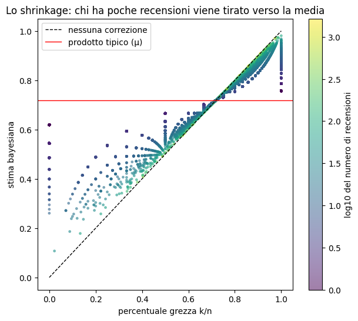
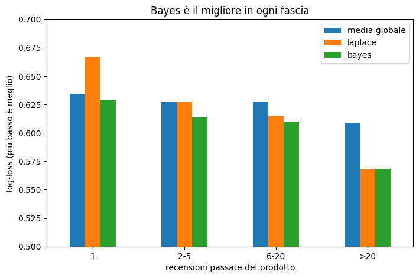

# Bayesian Shrinkage for Product Ratings

**How good is a product with only 3 reviews?** This project estimates the true share of satisfied customers for each Amazon product, even when it has very few reviews, using an empirical Bayes Beta-Binomial model. The estimates are validated on reviews written *after* the training period.

## Key result

On 179,784 future reviews of 16,024 products, the Bayesian estimate is the best predictor among the methods tested:

| Method | Log-loss | Brier score |
|---|---|---|
| **Bayesian shrinkage** | **0.596** | **0.203** |
| Laplace smoothing (k+1)/(n+2) | 0.604 | 0.206 |
| Global average | 0.621 | 0.214 |
| Raw percentage k/n | 1.040 | 0.234 |

It reduces the Brier score by **13%** vs. the raw percentage and **6%** vs. the global average, and it is the best method in every product segment.

## The problem

In the *All Beauty* category, the median product has **2 reviews** and 42% of products have only one. Ranking by raw percentage puts **37,873 products tied at 100%**, and 89% of them have 3 reviews or fewer. A product with 706 positive reviews out of 726 (97.2%) ranks **37,907th** by raw percentage and **8th** with the Bayesian estimate.

## Data

[Amazon Reviews 2023](https://amazon-reviews-2023.github.io/) (McAuley Lab, UC San Diego), category *All_Beauty*: 701,528 reviews, 2000–2023.

Cleaning:
- removed 7,300 exact duplicates and 299 repeated reviews by the same user on the same product;
- kept only **verified purchases** (90.5% of reviews; unverified ones were 5 points more positive);
- result: 628,189 reviews.

A review is **positive** if it has 4 or 5 stars (3 stars counts as not positive).

## Method

Each product *i* has an unknown true positive rate *pi*. Two assumptions:

- product quality across the catalog follows a **Beta(α, β)** distribution (the prior);
- given *pi*, the number of positive reviews *ki* out of *ni* is **Binomial(ni, pi)**.

α and β are estimated by **maximum likelihood** on the Beta-Binomial marginal distribution, using all products reviewed before 2021 (L-BFGS-B optimizer):

> α = 4.50, β = 1.77, i.e. prior mean μ = 0.72 and prior strength α+β ≈ 6.3 pseudo-reviews.

The estimate for each product is the posterior mean:

$$\hat p_i = \frac{k_i + \alpha}{n_i + \alpha + \beta}$$

Products with few reviews are pulled towards 72%; products with many reviews keep their own rate.

## Evaluation

- **Temporal split:** reviews before 2021-01-01 to estimate (448,405), reviews from 2021 on to test (179,784). Test set: 16,024 products present in both periods.
- **Metrics:** log-loss and Brier score over every future review (raw percentages clipped to [0.001, 0.999] for log-loss).

Log-loss by number of past reviews:

| Past reviews | Products | Raw | Global avg | Laplace | **Bayes** |
|---|---|---|---|---|---|
| 1 | 4,245 | 2.606 | 0.634 | 0.667 | **0.629** |
| 2–5 | 5,844 | 1.354 | 0.628 | 0.628 | **0.614** |
| 6–20 | 3,981 | 0.836 | 0.628 | 0.614 | **0.610** |
| >20 | 1,954 | 0.579 | 0.609 | 0.569 | **0.568** |

With a single review, Laplace smoothing is worse than the global average because it shrinks towards 50%. Learning the prior from data fixes this.

## Limitations

- The gain over the global average is modest (~4% log-loss): individual reviews are noisy.
- **Drift:** positive reviews drop from 73.0% before 2021 to 65.4% after, so every method over-predicts positives.
- A single prior for all products; adding product features (brand, price) would be a natural extension.

## Reproduce

1. Open `bayesian_product_rating.ipynb` in Google Colab.
2. Run all cells: the notebook downloads the data, cleans it, fits the model and produces the figures.

Requirements: `pandas`, `numpy`, `scipy`, `matplotlib`, `pyarrow`.
